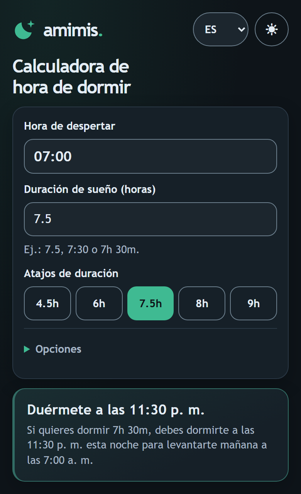
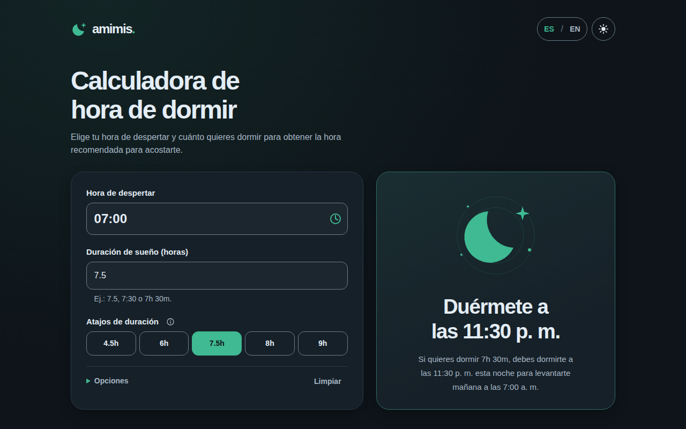

# Amimis

Calculadora web para estimar a qué hora dormirte según tu hora de despertar y la duración de sueño deseada.

**Pruébala en línea:** <https://ld9.dev/amimis/>

## Características

- Cálculo inmediato de hora recomendada para dormir.
- Entrada flexible de duración (`7.5`, `7,5`, `7:30`, `7h 30m`, etc.).
- Atajos rápidos: `4.5h`, `6h`, `7.5h`, `8h`, `9h`.
  El botón de información explica brevemente los ciclos de unos 90 minutos al pasar el mouse, enfocar o tocar.
- Soporte de idioma `ES/EN` con persistencia en `localStorage`.
- Modo claro/oscuro con persistencia.
- El idioma y el tema se recuerdan automáticamente, sin activar «Recordar tus valores».
  Limpiar el formulario no borra esas preferencias. Se conservan en el mismo
  navegador y dirección del sitio mientras el almacenamiento local esté disponible.
- Estado compartible vía query params (`wake`, `sleep`, `fmt`).
- UI responsive para escritorio y móvil; en móvil el resultado es compacto y no incluye la ilustración.
- Hora de despertar editable carácter por carácter: `07:30`, `7:30 AM` o `7:30 PM`.
  El cálculo y los enlaces guardan la hora normalizada en formato de 24 horas.
  El botón de reloj ofrece sugerencias cada 15 minutos sin limitar la escritura.
  Desde el campo, ↓ abre la lista; ↑/↓ recorren las horas, Enter elige y Esc o Tab cierran sin cambiar el valor.
- «Limpiar», junto a «Opciones», vacía solo la hora y la duración, sin confirmación ni cambios de preferencias.
- «Opciones» despliega el formato de salida, «Recordar tus valores» y «Restablecer».
  «Restablecer» confirma antes de borrar todos los valores del formulario, el estado guardado y la URL; conserva idioma y tema.

## Stack

- Vanilla TypeScript
- Vite
- CSS moderno (sin framework UI)

## Desarrollo local

Requiere Node.js compatible con Vite 7 (`^20.19.0 || >=22.12.0`) y npm.

```bash
npm ci
npm run dev
```

En Windows, detén los servidores Node/Vite del proyecto antes de repetir
`npm ci`: pueden mantener bloqueados los binarios de esbuild/Rollup (`EPERM`).

Abre **http://localhost:4173/amimis/**. `vite.config.ts` configura el puerto
4173 y la base `/amimis/`, que también se usa en el build.

Para probar en otros dispositivos de tu red local:

```bash
npm run dev -- --host 0.0.0.0 --port 4173
```

Abre `http://<IP-local>:4173/amimis/` desde el dispositivo de prueba.

## Scripts

- `npm run dev`: servidor de desarrollo.
- `npm run build`: build de producción en `dist/`.
- `npm run preview`: previsualiza el build.
- `npm run typecheck`: validación de tipos sin emitir archivos.

## Estructura

- `index.html`: shell de la app.
- `src/app.ts`: interacción UI/DOM, estado, eventos.
- `src/time.ts`: lógica pura de tiempo y parseo.
- `src/i18n.ts`: textos, idioma activo y persistencia.
- `src/styles.css`: estilos, temas, contraste y diseño móvil.
- `tests/`: comprobaciones de navegador ejecutadas con Playwright CLI.
- `.playwright/cli.config.json`: configuración compartida de Chromium aislado.
- `docs/harness-readiness.md`: estado técnico y preparación de `repo-harness-builder`.

## Revisión visual con Playwright

La configuración local de `.playwright/cli.config.json` usa Chromium aislado,
sin interfaz gráfica, igual que `ld9_dev_portfolio`. Las capturas y los snapshots
se guardan en `.playwright-cli/` (excluido de Git).

Requiere `playwright-cli` disponible en el terminal (validado con la versión
`0.1.22`). Si no está instalado:

```bash
npm install -g @playwright/cli@0.1.22
playwright-cli install-browser chromium
```

Con `npm run dev` activo, desde otro terminal en la raíz del proyecto:

```bash
playwright-cli -s=amimis open http://127.0.0.1:4173/amimis/
playwright-cli -s=amimis run-code --filename=tests/visual-checks.js
playwright-cli -s=amimis run-code --filename=tests/preferences-contrast.js
playwright-cli -s=amimis run-code --filename=tests/mobile-editing.js
playwright-cli -s=amimis run-code --filename=tests/theme-reload.js
playwright-cli -s=amimis run-code --filename=tests/wake-picker.js
playwright-cli -s=amimis close
```

La comprobación usa un contexto de navegador nuevo, sin los datos guardados de
la sesión habitual. Verifica el cálculo, los formatos, los errores, los atajos,
la URL, la persistencia, los idiomas, los temas, la limpieza, el foco y el
movimiento reducido. También comprueba desbordamientos y controles de al menos
44 × 44 px en anchos de 320, 375, 768, 1280 y 1920 px, en ambos temas.
Guarda capturas completas de móvil y escritorio para inspección visual.

`tests/preferences-contrast.js` comprueba que idioma y tema sobrevivan a recargas,
limpieza y reapertura de pestañas sin recordar el formulario. Mide el contraste
de textos y placeholders (mínimo 4,5:1), así como de bordes de controles y foco
(mínimo 3:1), incluidos los estados seleccionado, hover y error en ambos temas.
`tests/mobile-editing.js` prueba Backspace carácter por carácter, horas de 12/24 h,
validación, compatibilidad con URL/datos guardados y textos en español con tildes
y sin punto duplicado tras «p. m.». Comprueba que el resultado
quede dentro de la pantalla, con una tarjeta de hasta 180 px y texto principal
de 18–22 px, en 320×667, 375×812 y 390×844, en ES/EN y ambos temas. Las opciones
secundarias están contraídas; al desplegarlas puede ser necesario desplazarse.

`tests/theme-reload.js` compara los colores realmente calculados de fondo, texto
y tarjeta con la paleta seleccionada antes y después de recargar, con ambas
preferencias del sistema. Usa Chromium limpio: no cubre extensiones que
reescriban estilos ni el oscurecimiento forzado de otros navegadores.

`tests/wake-picker.js` comprueba las 96 sugerencias, selección con mouse y teclado,
cierre sin cambios, escritura libre, URL, traducciones, formato y ausencia de
desbordamiento en ambos temas a 320 px.

Estas comprobaciones específicas no sustituyen una auditoría completa de accesibilidad.

## Estado y siguiente paso

El harness está instalado para Pi. Consulta la [guía de uso](docs/repo-harness/usage.md)
y el [estado actual](docs/repo-harness/current-state.md). La
[preparación original](docs/harness-readiness.md) conserva la evidencia previa.

Después de instalar o actualizar las skills, ejecuta `/reload` en Pi. Para
comprobar las copias y su manifiesto: `python -B .repo-harness/check.py`.
Las memorias, sesiones y capturas de prueba no se versionan.

**Tema oscuro inesperado:** si el modo claro se ve oscuro, revisa extensiones
como Dark Reader o el modo oscuro forzado del navegador. Un reporte anterior se
debía a esa extensión, no a la app.

## Deploy

Compila con:

```bash
npm run build
```

Publica el contenido de `dist/` bajo `/amimis/` en tu hosting estático. Para
servirlo en otra ruta, revisa `base` en `vite.config.ts` y vuelve a compilar.
La versión en línea se publica en <https://ld9.dev/amimis/> con un procedimiento
local del autor; este repositorio no incluye despliegue automatizado.

## Licencia

[MIT](LICENSE) © 2026 Luis Cubero.

## Capturas

| Móvil | Escritorio |
| --- | --- |
|  |  |
